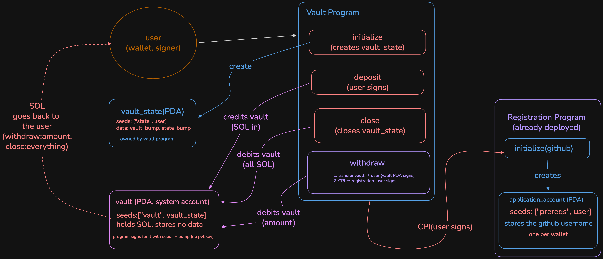

# Vault Program with a Registration CPI

An Anchor-based vault program on Solana that allows users to initialize a personal vault, deposit SOL, withdraw SOL, and close their vault.

For the **Turbin3 prerequisite challenge**, the `withdraw` instruction is extended with a **Cross-Program Invocation (CPI)** to the registration program, which records my GitHub username (`utkarsh-saxena271`) on-chain.

## Architecture



## How It Works

### Accounts

| Account | Type | Seeds | Purpose |
| --- | --- | --- | --- |
| `vault_state` | PDA owned by the vault program | `["state", user]` | Stores the vault and state bumps. |
| `vault` | PDA represented as a `SystemAccount` | `["vault", vault_state]` | Holds the deposited SOL without storing application data. |
| `application_account` | PDA owned by the registration program | `["prereqs", user]` | Stores the user's registration information, including their GitHub username. |

A Program Derived Address (PDA) has no private key. The vault program can authorize operations on behalf of its vault PDA by supplying the correct seeds and bump through `invoke_signed` or Anchor's equivalent CPI mechanisms.

### Instructions

- **`initialize`** — Creates the `vault_state` account, with the user paying the account's rent, and stores the relevant PDA bumps.
- **`deposit(amount)`** — Transfers the specified amount of SOL from the user to the vault through the System Program. The user signs the transfer.
- **`withdraw(amount)`** — Performs two operations:
  1. Transfers the requested amount of SOL from the vault to the user. The vault PDA authorizes the transfer using its seeds and bump.
  2. Makes a CPI to the registration program's `initialize` instruction, passing the GitHub username `utkarsh-saxena271`. The registration program creates the user's `application_account`.
- **`close`** — Transfers the remaining vault balance to the user and closes `vault_state`, returning its rent to the user.

Both operations inside `withdraw` are part of the same transaction. Solana transaction atomicity ensures that if the registration CPI fails, the preceding SOL transfer is also reverted.

## What I Changed

The original `withdraw` instruction only transferred SOL. I extended it to invoke the registration program through a CPI in `programs/pre-req-vault/src/instructions/withdraw.rs`.

The added code constructs the registration instruction's accounts and invokes its `initialize` method:

```rust
let cpi_accounts = Initialize {
    user: self.user.to_account_info(),
    account: self.application_account.to_account_info(),
    system_program: self.system_program.to_account_info(),
};

let cpi_ctx = CpiContext::new(
    self.application_program.key(),
    cpi_accounts,
);

initialize(cpi_ctx, "utkarsh-saxena271".to_string())?;
```

The registration program is already deployed. Its interface is imported from `idls/registration.json` using Anchor's `declare_program!(registration)` macro.

This integration demonstrates how one Solana program can invoke another program while composing multiple operations into a single atomic transaction.

## Devnet Deployment

- **Vault program ID:** `8Rrpn81KtsUL3cA57Jzsx2qPfcY2q76MP2ERTnYwgW9j`
- **Successful withdrawal transaction:** [View on Solana Explorer](https://explorer.solana.com/tx/5aB6BxDDSAD3YrS2gz8SUuAGZr2CTayi7keudsnDgBWrZqaExsFhUr4nWJMBWutzcqQqo6V9uJMCkxQmBnmji6sr?cluster=devnet)

## Note: One Registration Per Wallet

The registration program permits only one registration per wallet. After a wallet has registered successfully, another withdrawal that attempts to initialize the same registration account may fail with an `account already in use` error.

This is expected for an already-registered wallet. To test the complete registration flow again, use a fresh wallet that has sufficient Devnet SOL.

## Build and Test

### Requirements

- Rust, installed through [`rustup`](https://rustup.rs/)
- Solana CLI
- Anchor CLI, installed through AVM
- Node.js 22
- pnpm

### Commands

```bash
pnpm install
anchor build
anchor test
```

**Important:** The current `Anchor.toml` configures the provider to use Devnet and skips the local validator. These commands therefore operate according to that configuration; `anchor test` is not necessarily an isolated local test. The configured wallet at `~/.config/solana/id.json` needs sufficient Devnet SOL for the transactions and account creation.

When configuring your own deployment, ensure that the program ID in `declare_id!()`, the program keypair, generated IDL, and the relevant `Anchor.toml` entry are consistent. Use `anchor keys sync` when appropriate to synchronize the declared ID with the program keypair.

